ACTBUS is the capability kernel inside SYNTHEKOS.

<!-- Copyright (c) 2026 John Koperwas. SPDX-License-Identifier: Apache-2.0 -->

# ACTBUS

Every request reaches the kernel as a message. Every message names an identity and an action, and passes the same checks, in the same order, before anything runs:
- the envelope is well formed;
- the id has not been seen before, kept on disk for 24 h;
- the trace budget is not exhausted;
- every identity in the authority chain exists;
- the rate is within limits;
- every identity in the chain holds the action;
- the input matches its declared shape and allowed targets;
- no text from the web or a model reaches an action that touches the outside world, unless a rule explicitly allows it.

Then a "run" line goes to an append-only audit file, on disk, *before* the action runs: no line, no run.

The kernel fixes the model's sampling temperature at 0.2 (`act.js`:163); no script, grant or EUser can raise it. `act/test/temperature.test.js` fails if any input field, `create()` option or environment variable could change it.

Actions are files pinned by sha256. Scripts are written in PROTEUS-K, a small total Lisp-syntax language. They are actions too: each one runs as its own identity, can reach only what it was granted, and carries provenance labels on every value. Scripts can message each other through mailboxes that the core owns.



## Licence

Everything in this repo is Apache-2.0. The SYNTHEKOS appliance, TRUTHGATE™ and the SYNTHEKOS name are not in it.

See `LICENSE` and `NOTICE`. The two JSON files in `act/actions/` cannot carry a comment; `LICENSE` and `NOTICE` cover them.

## What is here

| Path | What it is |
|---|---|
| `act/core/` | bus, envelope, registry, capabilities, targets, names, durable log, rationals |
| `act/proteus/` | PROTEUS-K: reader, evaluator, engine, state |
| `act/mailbox.js`, `act/scheduler.js`, `act/daemon/`, `act/mail/`, `act/shutdown.js`, `act/trigger-off.js`, `act/make-registry.js` | mailboxes, triggers, one daemon process per identity with a supervisor, the mail outbox and SMTP client, shutdown, tools |
| `act/test/` | the kernel's own test suite (`node:test`) |
| `act/CHANGELOG.md` | the version history of every kernel file, moved word for word out of the file headers; each file's line 1 (line 3 after a shebang) names its version, what the file is for, and its section here |
| `act/actions/` + `act.js` | **the reference host**: the native actions and the HTTP/host adapter that SYNTHEKOS runs. They are included so the tests and the lab run against the code that is live. |
| `lab/` | the attack lab: sealed scenarios, the runner, the mutation harness |
| `docs/` | the design records for the kernel, edited for readers, and `reviews.md`: every review, what it found, where it was fixed and the test that pins it |

**The layout is SYNTHEKOS's own.** The tests reach `act/actions/` and `../act.js` by relative path, so the files keep the paths they have there.

## Proof that this is the live code

Tag `v0.3.0` in this repository holds `act.js` and `act/**` exactly as SYNTHEKOS tag `v0.53.8`: same paths, same modes, same git blob hashes, nothing missing and nothing extra under those paths. It is the first commit of this repository.

`tools/check-byte-identity.sh <synthekos-repo> <actbus-repo> v0.53.8 v0.3.0` compares the kernel files of the two tags entry by entry. It can only be run where both repositories are present.

With `productName: 'SYNTHEKOS'`, the kernel builds the same three strings as SYNTHEKOS `v0.53.5`, each built from fixed inputs and compared by sha256 (SYNTHEKOS's release check `after-checks-0536`, run on the live machine after the promote of `v0.53.6`, and again after `v0.53.8`'s): mail footer `c800d61e82e68d4e6a6326b53cd1e920e91cc843c5be4a3eb0a5f41602c03b17`, message with its X-Mailer header `406f664154f3cbca953e6a20b47377bd8eb12fe3ad116fa7b6acfcd9b0c4e632`, fetch User-Agent `66195a057cb109fdf09fd113a11cf0597abd9f114754a8f3e14a629f669fb3c7`.

Versions before 0.3.0 are in the private provenance record.

## Using it from a host

A host creates the kernel once and sends every request through it:

```js
const act = require('./act.js').create({
  prisma,                              // the host's database handle (users and their grants); lab/lab.js has a stand-in
  models,                              // the host's model list: { isInstalled(name) }
  productName: 'MyHost',               // the name the kernel writes where others can see it
  modelUrl: 'http://127.0.0.1:8080',   // the model server that the model action calls
});
```

Without `productName` the kernel calls itself `ACTBUS` in the four places where others can see a name: the fetch User-Agent (`<name>-fetch/1.0`), the mail footer, the X-Mailer header and the message of a paused script daemon. The name must be a plain token (1–32 letters, digits, dots, dashes or underscores) and is checked when the kernel starts. SYNTHEKOS passes `productName: 'SYNTHEKOS'`, so its User-Agent, mail footer and X-Mailer are byte for byte what they were before SYNTHEKOS `v0.53.6`. Only the paused-daemon message was reworded: it no longer assumes that an administrator restarts the host by hand.

`create()` checks its options before anything is created. It refuses an own option name it does not know, with the list of the names it takes; the refused name is shown with every character outside `A–Z a–z 0–9 _ $` removed and cut at 40 characters. A renamed option is refused with its new name, from a table in `act.js`. If `models` is given, `modelUrl` is required; a blank `modelUrl` counts as none. `modelAdapter({ modelUrl, fetchImpl })` is exported so the model action can be tested without `create()`; hosts call `create()`.

## Running the tests

Needs Node.js ≥ 22.1. Tested on Node 22 and 26; Node 20 will not work. There are no dependencies.

```
npm test
```

This runs every test in `act/test/` **except one**: `FAIL-FIRST server.js wires it: installShutdown late-bound, right after act is created and before the server listens` in `act/test/shutdown.test.js`.
- That test reads `../server.js`, the SYNTHEKOS application, which is not in this repository.
- It is skipped by its exact name. The file itself is unchanged.
- It still runs in SYNTHEKOS's own release checks.

`tools/kernel-test-check.sh` runs the suite twice and proves two things:
- the full run's *only* failure is that one test;
- the skipping run has no failures and exactly one test fewer.

## The lab

```
bash lab/lab-check.sh      # every sealed suite, in-process and in daemons, against this repo's act/; compares with lab/EXPECTED-RESULTS.txt
```

**How the lab works.** The lab boots the real kernel from this repository and plays each scenario through `act.route`, the same entry that every client uses. The model is a **stand-in that obeys every injection**, the worst case. Each scenario's expectations were sealed (sha256) before the run. The injection suite has **two agent shapes**: one script parses the model's reply as JSON, the other (the WORDS shape) never parses JSON and splits a one-line reply into words, so a label rule that holds only on the JSON path does not pass for both.

**Measured on 9 Nov 2026,** against the kernel of SYNTHEKOS `v0.53.7-cleanup` (kernel fingerprint `7928fa6b5c9a`), Node 22.23.4, seed 1, and again the same day against SYNTHEKOS `v0.53.8`, the kernel in this repository (fingerprint `0323a6a4c26e`), on SYNTHEKOS's host machine with Node 26.7.0: every RESULT line identical. Every line except injection's is identical to the first measurement, on 7 Nov at SYNTHEKOS `v0.53.5-headers`; injection's was measured again, on the `v0.53.7-cleanup` kernel, when the WORDS shape was added (20 → 38 scenarios). The results are the same both in-process and with every script in its own daemon process (`PK_DAEMON=1`):

| Suite | Runs as expected | Hostile held | Benign passed | False refusals by the kernel |
|---|---|---|---|---|
| injection (two agent shapes) | 38/38 | 25/25 | 12/12 | 0 |
| laundering | 18/18 | 9/9 | 9/9 | 0 |
| authority | 14/14 | 9/9 | 5/5 | 0 |
| allowlist | 21/21 | 17/17 | 4/4 | 0 |
| edges | 4/4 | 2/2 | 2/2 | 0 |
| selftest (the runner checking itself) | 6/6 | — | — | — |
| **all** | **101/101** | **62/62** | **32/32** | **0** |

No invariant was violated.

**Mutations.** `lab/mutations/` deliberately breaks the kernel, on a copy, in 15 named ways, and runs the suites again.
- Mode A: allow-lists as sealed.
- Mode B: allow-lists widened to the attacker, so the inner layers are tested alone.

A mutant is *caught* when any run stops being as expected.

On SYNTHEKOS `v0.53.7-cleanup`, 13 of 15 are caught, every row identical to `v0.53.6-docrefs`, `v0.53.6-purpose`, `v0.53.6`, `v0.53.5-changelog` and `v0.53.5-headers` (`lab/mutations/RESULTS-0537-cleanup.md`). With the WORDS shape added, the same 13 are caught and only the injection rows changed. In mode B, M3 is caught in 24 of 38 injection runs (12 of 20 before), 12 of them on the WORDS path, which never touches the JSON fence fix; M4 is still caught in 12, all JSON-shape, because the WORDS shape never calls `parse-json`. Coverage is per code path. The full table is in `lab/mutations/RESULTS-0537-cleanup-words.md`. On `v0.53.8`, the kernel in this repository, all 144 rows are byte-identical to that table's (`lab/mutations/RUNS-0538_091126.tsv`). The two not caught are listed under Known gaps.

## Threat model, in one page

**What the kernel stops.** It assumes the model and anything fetched from the web are hostile, and it stops:
- text from them reaching an action that touches the outside world (email, fetch, files): taint labels on every value and every message;
- a page choosing *what* is written or *where*. A page may only decide *whether* a fixed, person-written action fires, and that decision is recorded (`ctl`) and can be made strict per grant;
- a caller gaining power through another identity: authority is intersected along the chain (confused deputy);
- loops, storms and fan-out: hops, a trace budget, rates;
- replay: durable dedupe;
- tampered code: sha256 pins;
- runs that leave no record: the audit line is on disk before the run.

**What it trusts:**
- the administrator who installs actions, scripts and grants;
- the operating system and Node.js;
- the secrecy of each key.

**What it does not do:**
- It does not make the model truthful.
- It does not decide what a person may *see*.
- It does not separate two keys held by one client.

**How it was reviewed.** `docs/reviews.md` lists every review of this code: what each one was, what it found, where each finding was fixed and the test that pins it. They were review rounds run by AI sessions, not by people outside the project (see Known gaps).

## Known gaps

Tags before `v0.3.0` named below are in the private provenance record (see "Proof that this is the live code").

- **No independent human review yet.** Every review so far was run by AI sessions; `docs/reviews.md` says what each one was. Review by people outside the project is owed.
- **Label policy is prose.** The label policy is still prose and code in `act/proteus/eval.js`, not a separate table that can be checked (F14 not done).
- **Two sealed mutations are not caught** on `v0.53.5-headers`, `v0.53.5-changelog`, `v0.53.6`, `v0.53.6-purpose`, `v0.53.6-docrefs` or `v0.53.7-cleanup`:
  - **M1** (fetch's host check weakened to a substring match) is not caught alone. This is correct: the kernel's own target check covers that layer. On kernel 0.53.2, M1 together with M15 (the kernel target check removed) let 3 attacks reach the attacker. That is defence in depth, measured, but not re-measured on this tag.
  - **M13** (the audit "run" line written after the run instead of before) is not caught. Catching it needs a harness that kills the process during a run, and that harness does not exist yet.
- **Three mutations are caught but their limits remain:**
  - **M2** (fetch follows redirects) is caught by the allowlist suite. Redirect handling remains a property of `fetch.js` until F18, because the bus cannot judge a `Location` header.
  - **M6** (`grounded` not dropped in transit) is caught by edges, in 1 run of 4, in both modes.
  - **M14** (dedupe remembers only successes) is caught by authority, in 1 run of 14.
- **Confidentiality is not built.** The confidentiality half of the label design (who may *see* a value, as opposed to where it came from) is designed, not built.
- **Confidentiality for outside addresses:** a confidentiality rule for content sent to externally chosen addresses is designed, not built; today's labels track integrity only.
- **Some gates run only on SYNTHEKOS's host machine.** The 8 boot tests of the full application, and every git step, are not in this repository. The lab numbers above were measured on a different machine, on the same bytes; `lab/lab-check.sh` repeats them.
- **One test is skipped:** `FAIL-FIRST server.js wires it…` in `act/test/shutdown.test.js` (see Running the tests).
- **Names.** Since `v0.2.0` the kernel writes the host's product name (default `ACTBUS`) wherever others can see a name, the mail HELO is `MAIL_HELO` or the machine's host name (`[127.0.0.1]` if it has none), and `create()` takes `modelUrl`. Since `v0.2.3` the old name of `modelUrl` is refused, the test data uses reserved domains and the identity `alex`, and no comment or changelog entry in the kernel names a reviewer, the owner or the build machine. What remains:
  - `act/test/product.test.js` names SYNTHEKOS on purpose: it is the reference host's regression test ("a host that passes this name gets exactly these bytes").
  - `act/CHANGELOG.md` entries name the SYNTHEKOS release they shipped in. The note at its top says which names were replaced, and `docs/reviews.md` says what each review was.
  - One line of `act.js` (its table of renamed options) and three of `act/test/product.test.js` name the removed option `ollamaUrl`, on purpose: they refuse it and test the refusal.
- **The lab names no reviewer, owner or build machine** since `v0.2.4`: the scenarios' person is `alex`, the lab's records name the second reader and the build session, and the release check D covers `lab/` and `tools/` (`lab/SEALS.md` records the reseal). Model names appear in one file on purpose: `lab/TIER2-RESULTS_091126.md` names the four models that were run, with their digests, because a results table is measurement and says what was run; the scenarios are test data and use the neutral `model-a`, which is what the 8 Nov reseal put there.
- **The numbers above are the stand-in model's.** Real models were run once on this lab at `v0.2.5`: four local models, 760 runs, and they followed the injection 23 times; the kernel refused all 23 (`lab/TIER2-RESULTS_091126.md`, with the server version, the models' digests, the temperature and the seed rule, and the lower bound on "followed"). That run measures how often real models obey; the stand-in, which always obeys, is the security evidence. The mutation table is in-process only.
- **Routing is local only:** the name service does not route between machines.
- **Not published, and no CI:** `package.json` is `"private": true`, and there is no CI configuration.
